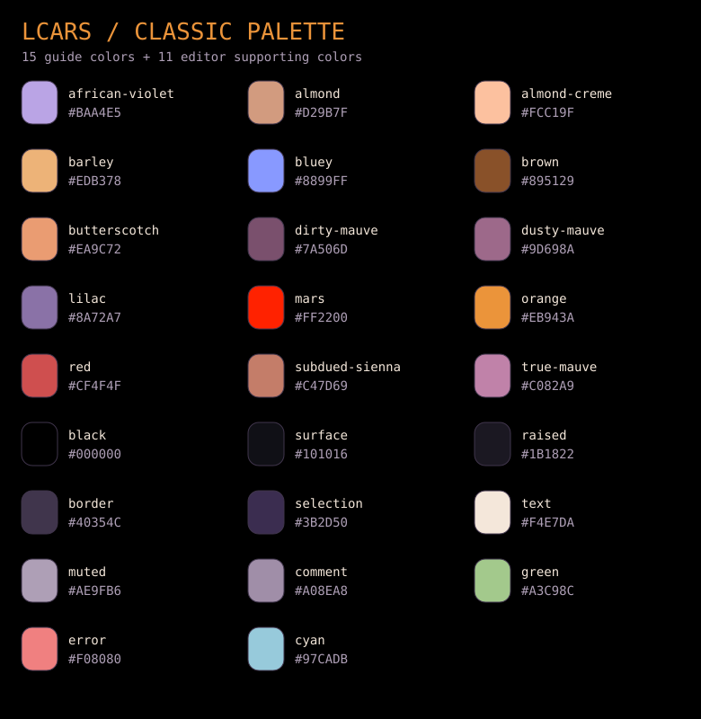

# lcars.nvim

A Star Trek LCARS-inspired Neovim colorscheme: black backgrounds, orange functions,
peach strings, violet keywords, and mauve numbers. Pure Lua, no dependencies.



*Palette reference, not an editor screenshot.*

Requires **Neovim 0.9+** and a terminal with true-color support. The theme enables
`termguicolors` and uses a dark background.

## Install

### lazy.nvim

Add this to your plugin specifications:

```lua
{
  "dgrzanov/lcars.nvim",
  lazy = false,
  priority = 1000,
  config = function()
    vim.cmd.colorscheme("lcars")
  end,
}
```

### vim-plug

```vim
call plug#begin()
Plug 'dgrzanov/lcars.nvim'
call plug#end()

colorscheme lcars
```

Run `:PlugInstall` and restart Neovim. If you already have a plug block, add only
its `Plug` line there and put `colorscheme lcars` after `plug#end()`.

### Native packages

```sh
git clone https://github.com/dgrzanov/lcars.nvim.git \
  ~/.local/share/nvim/site/pack/themes/start/lcars.nvim
```

Then add `vim.cmd.colorscheme("lcars")` to `init.lua`, or `colorscheme lcars` to
`init.vim`. If you use a custom `XDG_DATA_HOME`, adjust the installation path.

## Configure

No setup call is required. To customize, configure before loading the theme:

```lua
require("lcars").setup({
  transparent = false, -- Use the terminal background for main editor windows
  italic_comments = true,
  overrides = {},     -- Highlight definitions, or a function returning them
})
vim.cmd.colorscheme("lcars")
```

For example:

```lua
require("lcars").setup({
  transparent = true,
  italic_comments = false,
  overrides = function(colors)
    return {
      NormalFloat = { fg = colors.text, bg = "NONE" },
      FloatBorder = { fg = colors.african_violet, bg = "NONE" },
      Function = { fg = colors.orange, bold = true },
    }
  end,
})
vim.cmd.colorscheme("lcars")
```

Each `setup()` call starts from defaults. Reapply `:colorscheme lcars` after changing
options. Overrides replace the entire named highlight definition. Transparency
applies to main editor windows and sign/fold columns; menus and floats retain
contrasting backgrounds unless overridden. Access a copy of the palette with
`require("lcars").palette()`; color names use underscores.

## Coverage

- Neovim UI, Vim syntax, Tree-sitter captures, and LSP semantic tokens
- Diagnostics, diff views, spell checking, and 16 terminal colors
- Telescope, nvim-tree, Neo-tree, Gitsigns, nvim-cmp, and blink.cmp highlight groups
- An optional lualine theme:

```lua
require("lualine").setup({ options = { theme = "lcars" } })
```

These plugins are optional and are not installed by the theme. Syntax coverage
also depends on your parsers and language servers. The theme changes colors;
fonts and LCARS panel shapes are outside its scope.

## Development

```sh
nvim --headless -u NONE -l tests/smoke.lua
```

The smoke test checks loading, highlight links, options, overrides, terminal
colors, lualine, and switching away and back. CI runs on Neovim 0.9.5 and stable.
Edit `lua/lcars/palette.lua` for colors and `lua/lcars/init.lua` for highlight
mappings. `palette/lcars.json` records the original palette and provenance.

## Credits and license

Adapted from [LCARS Classic](https://github.com/dgrzanov/lcars-colorscheme), using
the Classic palette from [TheLCARS.com Color Guide](https://www.thelcars.com/colors.php)
with supporting colors for editor readability. See `palette/lcars.json` for provenance.
LCARS was designed by Michael Okuda. This fan project is unaffiliated with Star Trek's
owners or TheLCARS.com. Original code and documentation are [MIT licensed](LICENSE).
